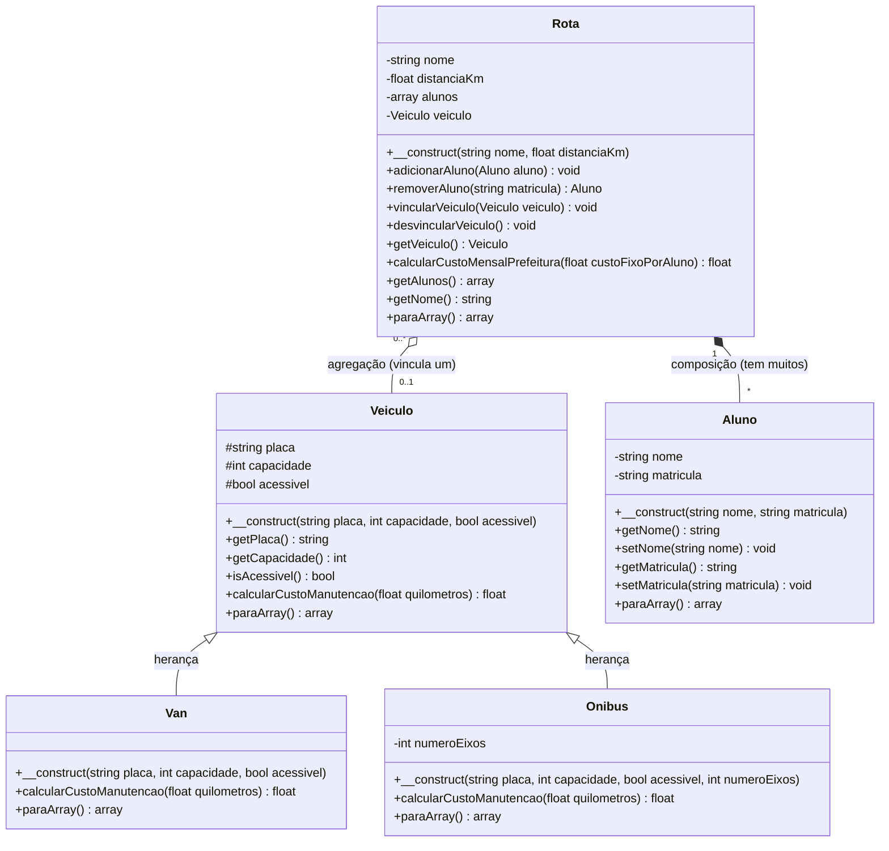

# Modelagem

## Diagrama de classes

Substitua o exemplo abaixo (tema 01, Feira Digital do Sertão) pelo diagrama do seu sistema.
Legenda: `<|--` herança ("é um"), `*--` composição ("tem um"), `#` protected, `-` private, `+` public.

## Justificativas

### Herança

A classe mãe é `Veiculo` e as classes filhas são `Van` e `Onibus`. A relação "é um" aplica-se perfeitamente, pois "Uma Van é um Veículo" e "Um Ônibus é um Veículo". Ambas herdam as características e validações básicas (placa, capacidade e acessibilidade), mas mantêm as suas particularidades. O método `calcularCustoManutencao()` foi sobrescrito em ambas as filhas porque cada tipo de transporte possui uma regra financeira distinta (a Van aplica um desconto sobre o valor base, enquanto o Ônibus acrescenta uma taxa extra multiplicada pelo número de eixos).

### Composição

A classe `Rota` guarda uma lista (array) de objetos da classe `Aluno`. A relação correta é "tem um" (ou "tem muitos") porque a `Rota` é constituída pelos estudantes alocados a ela ("A Rota tem alunos"). A relação não poderia ser "é um", pois um `Aluno` não é uma `Rota`; eles são conceitos totalmente distintos onde o objeto Aluno passa a existir como uma parte dentro do ciclo de vida e dos cálculos da Rota.

### Encapsulamento

**Têm Getter e Setter:** Os atributos da classe `Aluno` (`nome` e `matricula`) possuem tanto getters para leitura quanto setters altamente restritivos. Os setters bloqueiam números no nome, exigem que a matrícula tenha apenas dígitos e limitam o número de caracteres.

**Apenas Getter (sem Setter)**: Atributos da classe `Veiculo` (`placa`, `capacidade`, `acessivel`, `numeroEixos`) e da classe Rota (nome, distanciaKm) possuem apenas getters. Eles não têm setters de propósito: essas características estruturais devem ser definidas e validadas exclusivamente no momento da criação do objeto (no construtor) e não devem ser alteradas no meio da execução, garantindo a integridade dos dados na base JSON.
